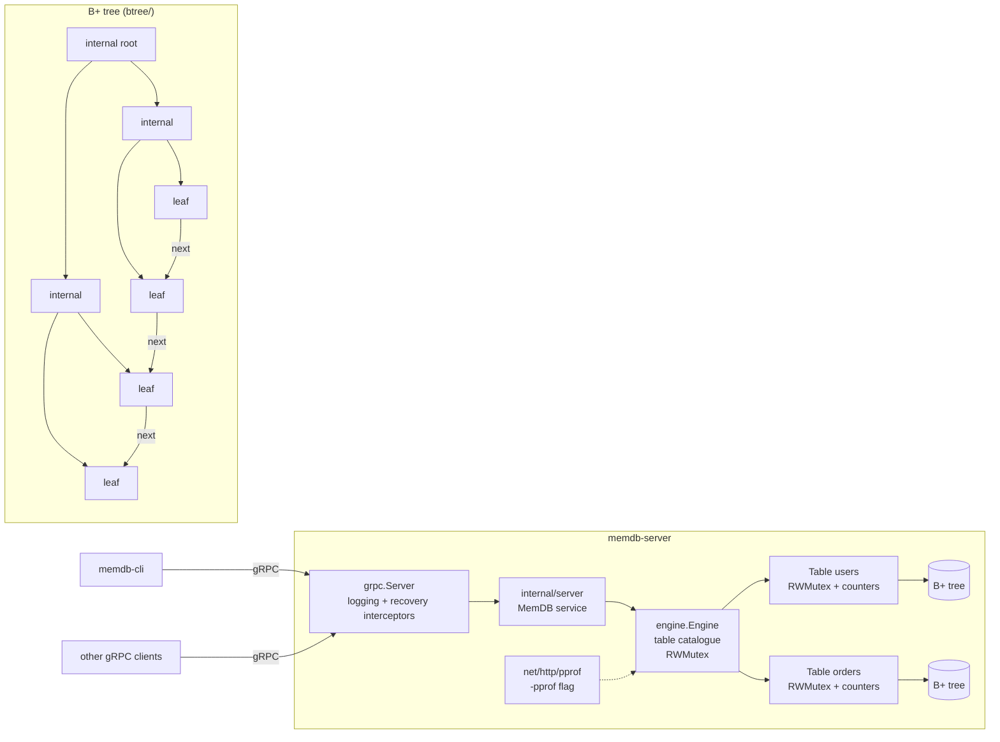

# MemDB

MemDB is an in-memory database engine in Go. Each named table is a
`[]byte`-keyed B+ tree behind its own `sync.RWMutex`, so point lookups and
range scans run in parallel and writes are exclusive. The engine is served
over gRPC and comes with a CLI client, `testing` benchmarks and pprof tooling.

- **B+ tree** (`btree/`): configurable order, values stored only in leaves,
  leaves linked left to right for range scans. Overflowing nodes split.
  Underflowing nodes borrow from a sibling or merge with it, and the root
  shrinks when it is left with one child. `Check()` verifies every structural
  invariant and the tests call it.
- **Engine** (`engine/`): a catalogue of named tables (create / drop / list)
  under its own `RWMutex`. Tables support `Put`, `Get`, `Delete`, `Scan`,
  `ScanPage` and `BatchPut`. `BatchPut` checks every entry first and then
  writes them all under one write lock, so readers see none of the batch or
  all of it. Atomic counters feed `Stats`.
- **gRPC API** (`proto/memdb.proto`, `internal/server/`): `CreateTable`,
  `DropTable`, `ListTables`, `Put`, `Get`, `Delete`, `Scan` (server
  streaming), `BatchPut`, `Stats`. Scans are streamed page by page, and the
  read lock is released before each page goes to the network.
- **Server** (`cmd/memdb-server`): graceful shutdown on SIGINT/SIGTERM, gRPC
  health and reflection services, and an optional `net/http/pprof` listener.
- **CLI** (`cmd/memdb-cli`).

All data lives in memory and is lost when the process exits. There is no
persistence or replication.

## Architecture



Locking has two levels. `Engine.mu` guards only the map from names to tables.
After a table has been looked up, every operation on it takes only that
table's lock: the read lock for `Get`, `Scan`, `ScanPage`, `Len` and `Stats`,
and the write lock for `Put`, `Delete` and `BatchPut`. Tables never contend
with each other.

## Layout

```
btree/             B+ tree: insert/split, delete/borrow/merge, range scans, invariant checker
engine/            tables, RWMutex locking, batch writes, stats
proto/memdb.proto  gRPC service definition
api/memdbpb/       generated Go code (created by `make proto`, not committed)
internal/server/   gRPC service implementation and interceptors
cmd/memdb-server/  server binary
cmd/memdb-cli/     command-line client
docs/profiling.md  how to profile and what to look for
```

## Building

You need Go 1.22+ and `protoc`. The generated protobuf code is **not
committed**, so generate it before you build anything that imports
`api/memdbpb`:

```sh
make tools    # installs protoc-gen-go and protoc-gen-go-grpc
make proto    # writes api/memdbpb/*.pb.go
make deps     # go mod tidy, writes go.sum
make build    # bin/memdb-server and bin/memdb-cli
```

Run `make proto` before `make deps`: `go mod tidy` has to see the generated
package. The `btree` and `engine` packages import only the standard library.

Or with Docker. The image runs the protobuf generation itself:

```sh
docker build -t memdb .
docker run --rm -p 7070:7070 memdb
```

## Running

```sh
./bin/memdb-server -addr :7070 -order 64 -tables users,orders
```

| Flag                       | Default   | Meaning                                              |
|----------------------------|-----------|------------------------------------------------------|
| `-addr`                    | `:7070`   | gRPC listen address                                  |
| `-order`                   | `0` (64)  | B+ tree order for new tables (minimum 3)             |
| `-tables`                  |           | comma-separated tables to create at startup          |
| `-scan-page`               | `256`     | entries copied per read-lock acquisition in `Scan`   |
| `-pprof`                   | off       | serve `net/http/pprof` on this address               |
| `-mutex-profile-fraction`  | `0`       | enable mutex profiling (used with `-pprof`)          |
| `-block-profile-rate`      | `0`       | enable block profiling (used with `-pprof`)          |
| `-shutdown-timeout`        | `10s`     | how long to drain in-flight RPCs on SIGINT/SIGTERM   |
| `-log-level`               | `info`    | `debug` logs every RPC                               |

The CLI:

```sh
memdb-cli create users
memdb-cli put users alice '{"age":31}'
memdb-cli get users alice
memdb-cli batch users bob=1 carol=2 dave=3
memdb-cli scan users b e          # keys in [b, e)
memdb-cli scan users "" "" 10     # first 10 keys
memdb-cli del users bob
memdb-cli stats
memdb-cli -addr otherhost:7070 tables
```

The server registers gRPC reflection, so `grpcurl` also works:

```sh
grpcurl -plaintext -d '{"table":"users","key":"YWxpY2U="}' localhost:7070 memdb.v1.MemDB/Get
```

## Testing

```sh
make test     # go test ./...
make race     # go test -race -count=1 ./...
```

- `btree/tree_test.go`: table-driven tests for inserts, overwrites, scan
  bounds, early stop, min/max, and deletes that exercise borrow and merge
  in both directions at several orders.
- `btree/random_test.go`: thousands of random put/delete/get/scan operations
  checked against a sorted-map reference, over several orders and seeds,
  with `Check()` run on the tree along the way and after a full random drain.
- `engine/engine_test.go`: table lifecycle, name/key/value validation,
  all-or-nothing `BatchPut`, scan limits and paging, and stats counters.
- `engine/concurrency_test.go`: concurrent writers and readers (gets, scans,
  stats) on one table, and concurrent catalogue changes. Run it under `-race`.
- `internal/server/server_test.go`: every RPC end to end over `bufconn`,
  including status codes and multi-page streaming scans.

## Benchmarks and profiling

```sh
make bench                                   # btree + engine benchmarks
make bench BENCH=ParallelMixed COUNT=5
make bench-profile                           # engine, with cpu/mem/mutex/block profiles in profiles/
make bench-profile PROFILE_PKG=btree
make pprof-cpu                               # open the CPU profile in the pprof web UI
```

The benchmarks cover sequential and random inserts, point lookups, range
scans of several lengths, deletes, batch writes, and `b.RunParallel`
workloads: parallel gets, and mixed gets/scans/puts at 50%, 90% and 99% reads.
[`docs/profiling.md`](docs/profiling.md) covers profiling the benchmarks and
a live server, and explains what each profile shows.
